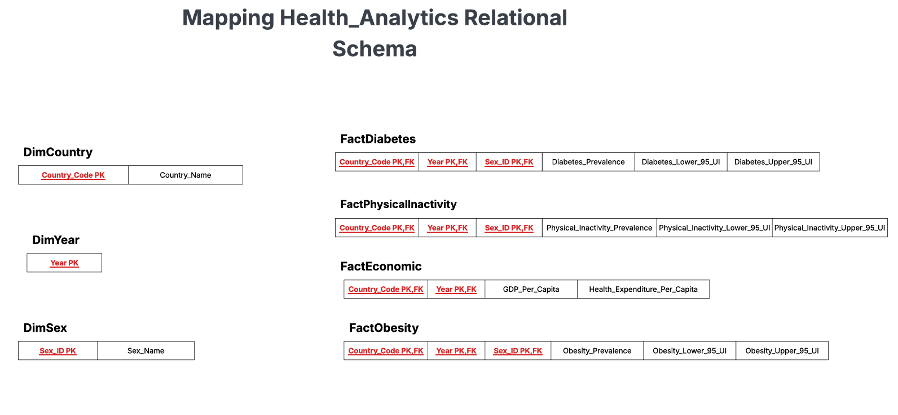
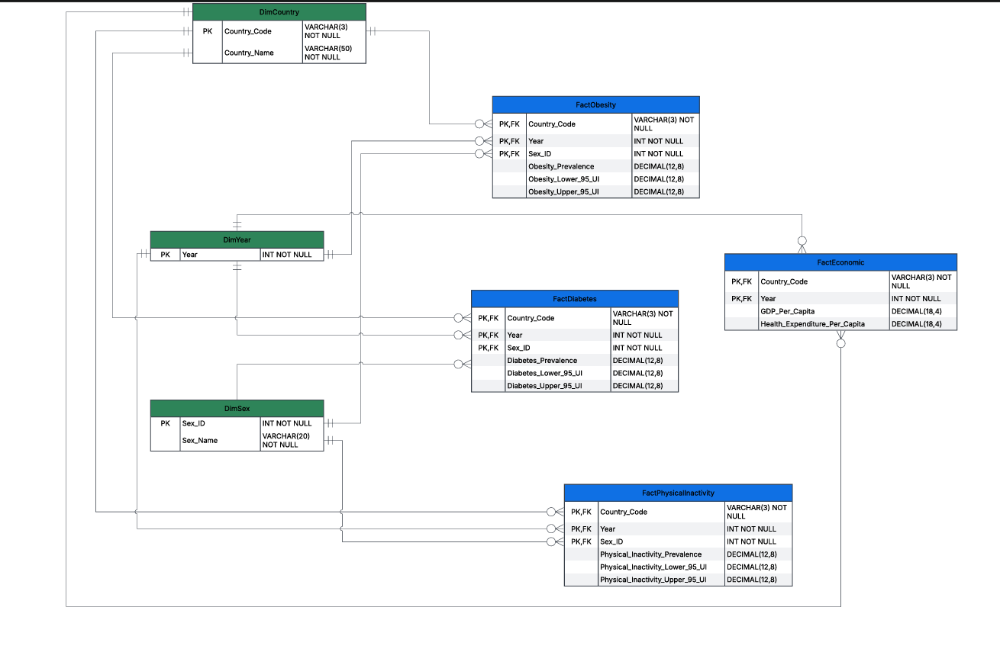
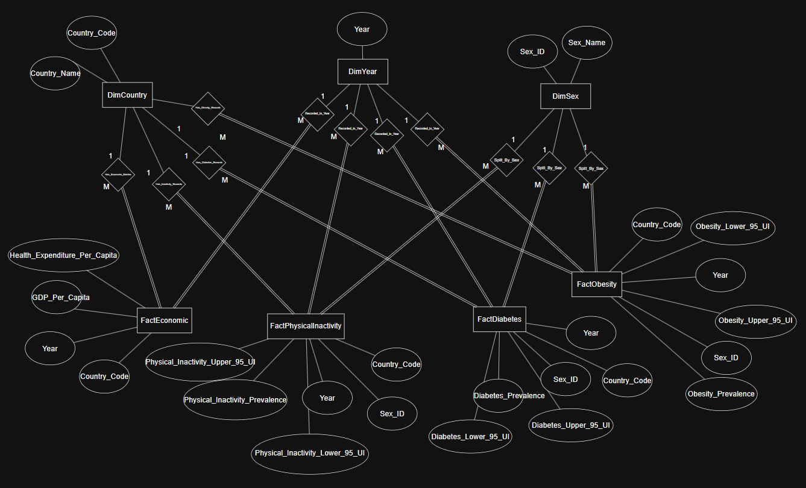
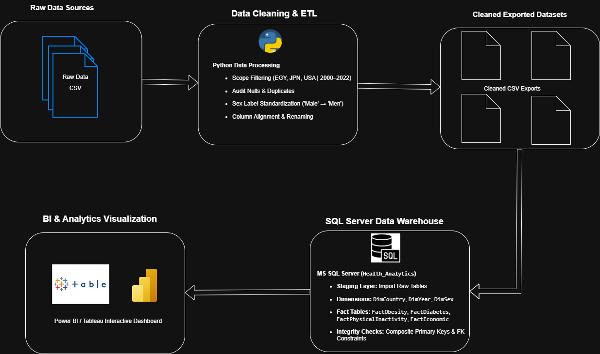

  <a href="README.md">⬅️ Back to Main README</a>

# System Analysis & Database Design Documentation

## 1. System Analysis & Design
* **Problem Statement:** Raw global health data (WHO, NCD-RisC) and economic metrics are unstructured and fragmented, making comparative cross-country analysis difficult[cite: 1].
* **Project Goals:** Build a structured SQL Server relational data warehouse (`Health_Analytics`) to integrate epidemiological health metrics alongside macroeconomic indicators[cite: 1].
* **Geographical & Temporal Scope:** Focus analytical tracking on Egypt, Japan, and the United States spanning a 23-year temporal timeline (2000–2022)[cite: 1].
* **ETL & Modeling:** Implement robust data cleaning workflows using Python (Pandas) to transform raw datasets into a normalized Star Schema architecture (`DimCountry`, `DimYear`, `DimSex`, and Fact tables)[cite: 1].

---

## 2. System Actors & Architecture
* **Data Analyst:** Cleans raw data via Python, audits nulls/duplicates, and exports normalized CSVs[cite: 1].
* **DBA:** Creates database schemas, manages keys/constraints, and builds analytical views[cite: 1].
* **BI Analyst:** Consumes analytical views via Power BI / Tableau dashboards for decision making[cite: 1].
* **Architecture Style:** Star Schema design in MS SQL Server separating reference data into dimensions and metrics into fact tables[cite: 1].

---

## 3. Database Design & Data Modeling
* **Overview:** A Star Schema featuring 3 Dimension Tables (`DimCountry`, `DimYear`, `DimSex`) linked via 1:N relationships to 4 Fact Tables (`FactObesity`, `FactDiabetes`, `FactPhysicalInactivity`, `FactEconomic`)[cite: 2].

  

  

* **Schema Specifications:**
  * **DimCountry:** Primary Key (`Country_Code`), Attributes (`Country_Name`)[cite: 2].
  * **DimYear:** Primary Key (`Year`), Attributes (Years 2000–2022)[cite: 2].
  * **DimSex:** Primary Key (`Sex_ID`), Attributes (`Sex_Name`: Men, Women, Both sexes)[cite: 2].
  * **Fact Tables:** Primary Key (`Country_Code` + `Year` + `Sex_ID`), Attributes (Prevalence / Economic metrics)[cite: 2].

  

---

## 4. Data Flow & Pipeline Architecture (ETL)
1. **Raw Data Sources:** The process begins with raw epidemiological and economic data provided in CSV format[cite: 3].
2. **Data Cleaning & ETL:** Data is processed using Python (Pandas) for scope filtering (Egypt, Japan, USA, 2000–2022), auditing nulls/duplicates, standardizing sex labels, and column alignment[cite: 3].
3. **Cleaned Exported Datasets:** Cleaned datasets are exported into structured CSV files ready for loading[cite: 3].
4. **SQL Server Data Warehouse:** Loaded into MS SQL Server (`Health_Analytics`) comprising a staging layer, dimensions, fact tables, and integrity validation via composite primary and foreign key constraints[cite: 3].
5. **BI & Analytics Visualization:** Final data is connected to create interactive dashboards and reports using Power BI and Tableau[cite: 3].

  

---

## 5. Technical Architecture & Validation
* **Tech Stack:** Python 3.14 (Pandas), MS SQL Server 17.0 (T-SQL), Power BI / Tableau[cite: 3].
* **Validation Plan:** Row count audits (138 health rows, 69 economic rows), zero-duplicate checks via `HAVING`, and `DBCC CHECKCONSTRAINTS`[cite: 3].
